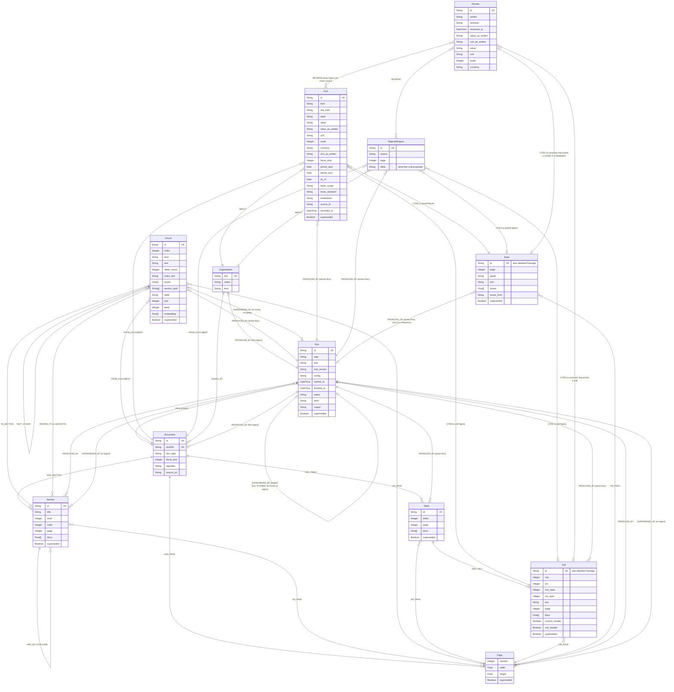

# Graph schema

The nodes and relationships that `Neo4jStore.record_parse`, `record_chunks`, `record_embeddings`, `record_extraction` and `record_review` (`backend/src/bloomberg_invest/adapters/store/neo4j_store/`) write for one ingested filing. Update this file when the store writes a new label, property or relationship.

The diagram gives the shape; [Attributes](#attributes) gives every property's meaning and an example from the Maroc Telecom 2025 report.



Arrows in Cypher run from the first entity to the second, for example `(:Document)-[:ISSUED_BY]->(:Organisation)` and `(:Run)-[:PROCESSED]->(:Document)`.

## Nodes, labels and relationships

- **Every box is a node label.** A node can carry more than one label.
- **Passage is a second label, not a node type of its own.** Every Cell node is `:Cell:Passage` and every Span node is `:Span:Passage`. A Passage is what a Fact cites, or a correction: the table cell or the quoted sentence its value comes from. Reads match `(:Fact)-[:CITES]->(:Passage)` so they need not ask which kind it is. No node is a Passage alone.
- **Relationships carry no properties.** Their type and direction are the whole meaning; anything worth recording, such as when or by which tool, is a property of a node, usually the Run that `PRODUCED_BY` points to.

One figure, as stored:

```
(:Organisation {isin: "MA0000011488"})<-[:ABOUT]-(f:Fact {line_item: "revenue", value_as_written: "36 681"})
(f)-[:CITES]->(:Cell:Passage {text: "36 681", row: 1, col: 3})-[:ON_PAGE]->(:Page {number: 4})
(f)-[:FROM_DOCUMENT]->(:Document {doc_type: "annual_report", fiscal_year: 2025})
(f)-[:PRODUCED_BY]->(:Run {step: "extract", tool: "azure-openai"})
(:Table {page: 4})-[:HAS_CELL]->(the Cell)
```

## Attributes

An optional property is absent from the node when it has no value: Neo4j stores no nulls. Boxes are in PDF points with a top-left origin; see [Why a Page has width and height](#why-a-page-has-width-and-height).

### Organisation

| Property | Type | Meaning | Example |
| --- | --- | --- | --- |
| `isin` | String, unique | the ISIN given on the CLI | `MA0000011488` |
| `name` | String | as given on the CLI | `Maroc Telecom` |
| `kind` | String | `company` for now | `company` |

### Document

| Property | Type | Meaning | Example |
| --- | --- | --- | --- |
| `id` | String, unique | UUID | `c5709e7d-f060-41a4-8764-f76960b98aba` |
| `sha256` | String, unique | of the PDF; a re-ingest matches on it | `90e8b73c7f11…` |
| `doc_type` | String | `annual_report`, `half_year_report` or `issuer_page` | `annual_report` |
| `fiscal_year` | Integer | the year the filing reports on | `2025` |
| `regulator` | String | always `AMMC` | `AMMC` |
| `source_url` | String, optional | where the PDF was downloaded | `https://www.ammc.ma/…/Maroc_Telecom_RFA_2025.pdf` |

### Run

One execution of a step. `config` is a JSON string whose keys depend on the step.

| Property | Type | Meaning | Example |
| --- | --- | --- | --- |
| `id` | String, unique | UUID | `0d43fb28-03f5-42c5-b558-2fc4512df0eb` |
| `step` | String | `parse`, `chunk`, `embed` or `extract` | `parse` |
| `tool` | String | `docling`, `bloomberg-chunker`, `sentence-transformers` or `azure-openai` | `docling` |
| `tool_version` | String | the tool's package version | `2.145.0` |
| `config` | String (JSON) | the settings the output depends on | see below |
| `started_at`, `finished_at` | DateTime | UTC | `2026-11-09T13:36:59Z` |
| `status` | String | `succeeded` or `failed` | `succeeded` |
| `error` | String, optional | set when failed | `RuntimeError: …` |
| `output` | String, optional | the tool's full output file, under `data/` | `parses/90e8b73c…/20261109T133659Z-docling.json` |
| `superseded` | Boolean, optional | embed Runs only | `true` |

`config` by step:

- **parse:** `{"do_cell_matching": "true", "mode": "accurate", "table_structure": "TableFormer v1"}`
- **chunk:** `{"cap": "2000", "table_cap": "1500", "tokenizer": "cl100k_base", "parser": "docling 2.145.0", "parse_run": "0d43fb28-…"}`
- **embed:** `{"model": "Qwen/Qwen3-Embedding-0.6B", "max_tokens": "2048", "chunk_run": "59e09a42-…"}`
- **extract:** `{"api": "openai/v1", "deployment": "gpt-5.6-sol", "prompt": "extract-figures v1", "prompt_sha256": "2e0590a8…", "label_map": "v1", "label_map_sha256": "7ef25890…", "pages": "88", "parse_run": "0d43fb28-…", "replayed": "true"}`

### Page

| Property | Type | Meaning | Example |
| --- | --- | --- | --- |
| `number` | Integer | from 1 | `4` |
| `width`, `height` | Float | PDF points | `595.32`, `841.92` (A4 portrait) |
| `superseded` | Boolean, optional | | `true` |

### Section

| Property | Type | Meaning | Example |
| --- | --- | --- | --- |
| `id` | String, unique | UUID | `1a4e2219-…` |
| `title` | String | the heading as printed | `1.1 Chiffres consolidés en dirham` |
| `level` | Integer | from the heading's numbering, 1 at the top | `2` |
| `order` | Integer | document order, parents before children | `3` |
| `page` | Integer | the heading's page | `4` |
| `bbox` | Float[4], optional | the heading's box: left, top, right, bottom | `[82.0, 142.5, 272.0, 153.2]` |
| `superseded` | Boolean, optional | | `true` |

### Chunk

| Property | Type | Meaning | Example |
| --- | --- | --- | --- |
| `id` | String, unique | UUID | `4a23a048-…` |
| `index` | Integer | reading order in the Document | `75` |
| `kind` | String | `text` or `table` | `table` |
| `text` | String | headings and paragraphs joined, or the table (part) as Markdown with its header | `TABLEAU DES FLUX DE TRÉSORERIE CONSOLIDÉS ⏎ \| (En millions MAD) \| …` |
| `token_count` | Integer | cl100k tokens in `text` | `622` |
| `index_text` | String | what is embedded: section path and pages, then the text | `3. COMPTES CONSOLIDÉS … > TABLEAU DES FLUX … ⏎ …` |
| `boxes` | Float[] | its blocks' regions, five numbers each: page, left, top, right, bottom | `[25, 48.6, 59.4, 377.8, 71.1, …]` |
| `section_path` | String[] | Section titles from the top down | `["3. COMPTES CONSOLIDÉS …", "TABLEAU DES FLUX DE TRÉSORERIE CONSOLIDÉS"]` |
| `table` | String, tables only | shared by the parts of one table | `7feb1ce9-…` |
| `part`, `parts` | Integer, tables only | this part's number from 1, and how many | `1`, `2` |
| `embedding` | Float[1024], optional | set by an embed Run | 1,024 floats |
| `superseded` | Boolean, optional | a superseded Chunk loses `index_text` and `embedding` | `true` |

### Table

| Property | Type | Meaning | Example |
| --- | --- | --- | --- |
| `id` | String, unique | UUID | `b66e5c20-…` |
| `index` | Integer | position in the Document | `1` |
| `page` | Integer | | `4` |
| `bbox` | Float[4] | left, top, right, bottom | `[52.8, 193.8, 520.1, 335.2]` |
| `superseded` | Boolean, optional | | `true` |

### Cell (also `:Passage`)

| Property | Type | Meaning | Example |
| --- | --- | --- | --- |
| `id` | String, unique | UUID | `c0556947-…` |
| `row`, `col` | Integer | from 0 | `1`, `3` |
| `row_span`, `col_span` | Integer | merged cells span more than 1 | `1`, `1` |
| `text` | String | as the parser read it | `36 681` |
| `page` | Integer | | `4` |
| `bbox` | Float[4] | left, top, right, bottom | `[488.1, 221.2, 515.7, 229.3]` |
| `column_header`, `row_header` | Boolean | | `false`, `false` |
| `superseded` | Boolean, optional | | `true` |

### Span (also `:Passage`)

A figure quoted in a paragraph rather than read from a table.

| Property | Type | Meaning | Example |
| --- | --- | --- | --- |
| `id` | String, unique | UUID | `85a8f122-…` |
| `page` | Integer | | `10` |
| `quote` | String | the value as quoted | `4,00` |
| `text` | String | the whole paragraph | `Le Conseil d'Administration de Maroc Telecom proposera à la prochaine Assemblée Générale …` |
| `boxes` | Float[] | five numbers per region: page, left, top, right, bottom | `[10, 173.0, 464.5, 190.1, 472.3]` |
| `boxes_from` | String | `quote` when the quote was found in the PDF's text layer, else `paragraph` | `quote` |
| `superseded` | Boolean, optional | | `true` |

### Fact

A financial figure that passed the check. Example: consolidated revenue for 2025.

| Property | Type | Meaning | Example |
| --- | --- | --- | --- |
| `id` | String, unique | UUID | `06bb8020-…` |
| `kind` | String | `financial_figure`; other kinds come later | `financial_figure` |
| `line_item` | String | key in the label map, which gives its title and statement | `revenue` |
| `label` | String | the filing's own wording: the row label, or the sentence | `Chiffre d'affaires` |
| `value_as_written` | String | exactly as printed | `36 681` |
| `unit_as_written` | String | the unit as the LLM read it | `MAD millions` |
| `value` | String | exact decimal in the base unit | `36681000000` |
| `unit` | String | `MAD`, `%`, `shares` or `MAD/share` | `MAD` |
| `scale` | Integer | 1, 1000, 1000000 or 1000000000 | `1000000` |
| `currency` | String, optional | absent for `%` and `shares` | `MAD` |
| `fiscal_year` | Integer | | `2025` |
| `period_start`, `period_end` | Date, flows only | the period it covers | `2025-01-01`, `2025-12-31` |
| `as_of` | Date, stocks only | the day a balance holds on | `2023-12-31` (current assets, FY2023) |
| `basis_scope` | String | `consolidated` or `company-only` | `consolidated` |
| `basis_standard` | String | `IFRS` or `CGNC`, from the scope | `IFRS` |
| `breakdown` | String | empty for the line item itself, else the part | `""`; `basic` for basic EPS |
| `source_id` | String | the id the LLM cited on its page: `t<page>.<table>.r<row>.c<col>` or `p<page>.<paragraph>` | `t4.0.r1.c3` |
| `recorded_at` | DateTime | when the extract Run stored it | `2026-11-09T22:12:43Z` |
| `superseded` | Boolean, optional | | `true` |

### RejectedFigure

What the LLM proposed, kept with the reason the check refused it. It holds only what the LLM said and what was read from its source: `id`, `kind`, `line_item`, `label`, `value_as_written`, `unit_as_written`, `fiscal_year`, `basis_scope` (when valid), `breakdown`, `source_id` and `recorded_at`, as on a Fact, plus the two below. The parsed properties (`value`, `unit`, `scale`, `currency`, the period and `basis_standard`) are never set.

| Property | Type | Meaning | Example |
| --- | --- | --- | --- |
| `reason` | String | one of the reasons below | `its value differs from its cell` |
| `page` | Integer | the page the LLM read | `26` |

The reasons, in the order they are checked: `its source id is not on the page`, `its value differs from its cell`, `its value is not in its paragraph`, `its value is not one number`, `its unit names no currency, percentage or share count`, `its line item is not in the label map`, `its scope is neither consolidated nor company-only`.

Examples:
- **Value differs:** the LLM proposed `18 002` for equity, but the cell it cited reads `propres 18 002`, part of a label merged into it. It `CITES` that Cell.
- **Unknown source:** the LLM cited `t46.0.r8.c2+t46.0.r8.c3`, two cells joined, which is no id on page 46. It cites nothing.

### Review

A person's check of figures in CHECKS (#23). One Review `REVIEWS` every figure of one CHECKS row: the Facts of one filing stating one value of a line item and year, or one RejectedFigure. A correction's properties are absent on an acceptance or a reopening.

| Property | Type | Meaning | Example |
| --- | --- | --- | --- |
| `id` | String, unique | UUID | `5e1f0c2a-…` |
| `verdict` | String | `accepted`, `corrected`, or `reopened` to undo the check before | `corrected` |
| `reviewer` | String | the app's `REVIEWER` setting | `Z. Bajjou` |
| `reviewed_at` | DateTime | UTC | `2026-11-10T14:02:11Z` |
| `value_as_written` | String, corrections | the right value, as the person gave it | `17 920` |
| `unit_as_written` | String, corrections | the figure's own, which the value is read in | `MAD millions` |
| `value`, `unit`, `scale`, `currency` | corrections | parsed as on a Fact | `17920000000`, `MAD`, `1000000`, `MAD` |

## Constraints and keys

Neo4j Community enforces uniqueness only. Required properties are enforced by the Pydantic domain models every write goes through (ADR 0003).

| Label | Unique | Matched on when ingesting |
| --- | --- | --- |
| Organisation | `isin` | `isin`, given on the CLI |
| Document | `id`, `sha256` | `sha256` of the PDF |
| Run | `id` | always created |
| Section | `id` | always created |
| Page | none | always created, per Run |
| Chunk | `id` | always created, per chunk Run |
| Table, Cell | `id` | always created, per parse Run |
| Fact, RejectedFigure, Span | `id` | always created, per extract Run |
| Review | `id` | always created, per check; never superseded |

The vector index `chunk_embedding` covers `Chunk.embedding`, cosine, at full precision: Neo4j quantizes vectors to bits by default, which would change the ranking the notebook measured.

## Superseded

A Page or Section with `superseded = true` came from an older parse of the same filing. A newer parse replaced it; the node is kept for history but hidden from the app.

1. Run A parses the PDF and writes its Pages and Sections, all current.
2. The same PDF is ingested again. The Document is matched by its `sha256`, so Run B processes the same Document.
3. In the same transaction, every current node Run A produced for this Document gets `superseded = true` and a `SUPERSEDED_BY` link to Run B.
4. Run B writes fresh Pages and Sections. Every read filters with `coalesce(n.superseded, false) = false`, so only Run B's output shows. The exceptions are the reads by id (`GET /api/chunks/{id}`, `GET /api/facts/{id}`), which return a node current or not so a link to it keeps working after a re-run.

A chunk Run supersedes only the Chunks of earlier chunk Runs, never the parse's Pages and Sections. An extract Run likewise supersedes only earlier extract Runs' Facts, RejectedFigures and Spans; a new parse supersedes its Tables and Cells and, through them, every figure extracted from them. A new parse supersedes everything earlier Runs produced for the Document, Chunks included; ingest then chunks the new parse. A superseded Chunk loses its `index_text` and `embedding`, so it leaves the vector index and search never returns it.

An embed Run sets the `embedding` of every current Chunk of its Document, never some of them, so its `PROCESSED` link to the Document says which Run made each vector: there is no link per Chunk. Its `config` names the model and the chunk Run it embedded. An embed Run vouches for the vectors of the current Chunks, so whatever replaces them ends it: a later embed Run, a re-chunk or a new parse marks it `superseded` with `SUPERSEDED_BY`, in the same transaction. A Document whose re-chunk stopped before its embed therefore has no current embed Run, rather than one naming Chunks that are gone.

Old nodes are never deleted (ADR 0002): anything that cited them stays traceable, and two parses can be compared. The property is absent on current nodes. Organisation and Document are shared across runs and never superseded, and of the Runs only embed Runs are; the Organisation and Document link by `PRODUCED_BY` to the Run that first created them, and a re-ingest only matches them.

## Failed Runs

A parse that fails still leaves a Run, with `status = 'failed'` and `error` set (for example `RuntimeError: ...`). It writes no Pages or Sections and supersedes nothing, so the last good parse stays current. Reads use the latest succeeded parse Run only; a filing with no succeeded parse is not listed. A failed chunk, embed or extract Run works the same way: no Chunks or vectors written, nothing superseded, the last good ones stay current.

## Where section text lives

In Chunks. A Section holds only its heading: `title`, `page`, the heading's `bbox`, `level` (inferred from the heading's numbering, since Docling returns every heading at level 1) and `order` (document order, parents before children). A section runs from its heading to the next heading at the same or a higher level.

The body text is in the stored PDF (`data/documents/<sha256>.pdf`) and in Docling's full output, which every successful parse saves to `data/parses/<sha256>/<started_at>-docling.json` and names in `Run.output`. The chunk Run reads that file instead of parsing again (`bloomberg chunk <document id>` re-runs it). A section's paragraphs form one text Chunk under the `CHUNK_CAP` (2,000 cl100k tokens), split at numbered points, otherwise evenly between paragraphs; each table, joined across pages, is its own Chunk holding its Markdown. A table whose rows, read one line per row as search reads them, are over the `TABLE_CAP` (1,500 cl100k tokens) is cut evenly between rows; each part repeats the column header and the headings above the table, keeps the pages and boxes of its own rows, and shares a `table` id with the other parts (`part` of `parts`). A heading starts the Chunk after it, so the Section's title is in its text and no text is lost when Docling takes a sentence for a heading; a heading with no content of its own joins the next Chunk. Chunks are the search unit (ADR 0004).

## Where figures live

A financial figure is a Fact (ADR 0001) of kind `financial_figure`, extracted page by page by an LLM and checked in Python before it is stored (#19 R6). It `CITES` its Passage: the table Cell holding its number, or a Span, the quoted value in its paragraph. Every Table and Cell comes from the parse, with its page and box, so the source viewer can highlight the exact cell.

A figure that fails the check is stored as a `RejectedFigure` with its `reason`, never with the `Fact` label: a query on `:Fact` cannot show one. A RejectedFigure still `CITES` the Cell or Span it named, for the review queue (#23), and is `ABOUT` its Organisation and `FROM_DOCUMENT` its Document like a Fact. Every RejectedFigure keeps the `page` the LLM read, because one whose source id is not on the page has no Passage to cite; a Fact's page is its Passage's.

A Fact keeps the label map's `line_item` key only; its title and statement are read from the label map in force. A Span's boxes are the quote's, found in the PDF's text layer inside its paragraph, so the viewer highlights the value; when the text layer does not hold the quote there, they are the paragraph's (`boxes_from`).

`value` is a string because Neo4j has no decimal type and a float would make `4,01` unequal to `4.01`. The extract Run's `config` names the deployment, the prompt and label map versions with their SHA-256, and the parse Run it read.

## Where checks live

A figure's check in force is its latest `Review` (by `reviewed_at`), unless that one reopened it. Reviews are never superseded or deleted: a mistaken check is undone by a reopening, and both stay. Only consolidated figures that feed a KPI or screen need a check; `config/kpis/` names those inputs.

A correction never changes the figure: the Review holds the right value, and it wins wherever the figure is read (ADR 0001). It `CITES` what the person picked: a Cell of the figure's table row, or a new Span holding a number of the figure's paragraph, boxed on that number in the PDF's text layer. Such a Span has no `PRODUCED_BY`: its Review is its provenance, so a re-extract never supersedes it. A typed value cites nothing. The dossier shows a corrected figure with its correction, sourced from what the Review cites, or for a typed value from what the figure was read from; a RejectedFigure joins the dossier once corrected.

An extract Run carries checks over in its own transaction (#19 R4). A new figure gains a `REVIEWS` link from the check in force of the previous extract Run's figure that read the same thing:
- the same line item, fiscal year, scope, breakdown, `value_as_written` and `unit_as_written`;
- from the same source: for a Cell, the same page, table index, row and column, which survive a re-parse; for a Span, the same page, quote and paragraph.

Any other new figure starts unchecked and goes back to CHECKS, and so does every figure with no Passage: its page and `source_id` are not the same Cell. Only the Run just before counts, so a check undone by a different reading does not come back when a later Run reads the first value again.

## Why a Page has width and height

`bbox` is in PDF points with a top-left origin. To highlight a source on the page image at any screen size, the viewer places the box as fractions of the page: `left / width`, `top / height`. Sizes are stored per page because reports mix portrait A4 (595 × 842 pt) with landscape tables. The viewer also sets them on the page image so it keeps its shape while loading.
