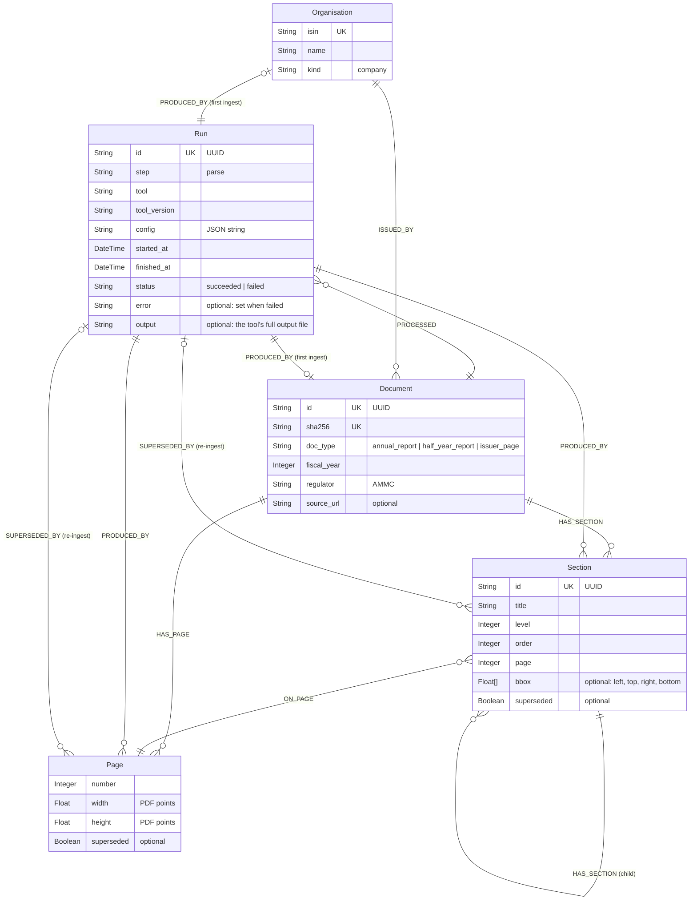

# Graph schema

The nodes and relationships that `Neo4jStore.record_parse` (`backend/src/bloomberg_invest/adapters/store/neo4j_store.py`) writes for one ingested filing. Update this file when the store writes a new label, property or relationship.

Arrows in Cypher run from the first entity to the second, for example `(:Document)-[:ISSUED_BY]->(:Organisation)` and `(:Run)-[:PROCESSED]->(:Document)`.

## Constraints and keys

Neo4j Community enforces uniqueness only. Required properties are enforced by the Pydantic domain models every write goes through (ADR 0003).

| Label | Unique | Matched on when ingesting |
| --- | --- | --- |
| Organisation | `isin` | `isin`, given on the CLI |
| Document | `id`, `sha256` | `sha256` of the PDF |
| Run | `id` | always created |
| Section | `id` | always created |
| Page | none | always created, per Run |

## Superseded

A Page or Section with `superseded = true` came from an older parse of the same filing. A newer parse replaced it; the node is kept for history but hidden from the app.

1. Run A parses the PDF and writes its Pages and Sections, all current.
2. The same PDF is ingested again. The Document is matched by its `sha256`, so Run B processes the same Document.
3. In the same transaction, every current node Run A produced for this Document gets `superseded = true` and a `SUPERSEDED_BY` link to Run B.
4. Run B writes fresh Pages and Sections. Every read filters with `coalesce(n.superseded, false) = false`, so only Run B's output shows.

Old nodes are never deleted (ADR 0002): anything that cited them stays traceable, and two parses can be compared. The property is absent on current nodes. Organisation, Document and Run are shared across runs and never superseded; the Organisation and Document link by `PRODUCED_BY` to the Run that first created them, and a re-ingest only matches them.

## Failed parses

A parse that fails still leaves a Run, with `status = 'failed'` and `error` set (for example `RuntimeError: ...`). It writes no Pages or Sections and supersedes nothing, so the last good parse stays current. Reads use the latest succeeded parse Run only; a filing with no succeeded parse is not listed.

## Where section text lives

Not in the graph yet. A Section holds only its heading: `title`, `page`, the heading's `bbox`, `level` (inferred from the heading's numbering, since Docling returns every heading at level 1) and `order` (document order, parents before children). A section runs from its heading to the next heading at the same or a higher level.

The body text is in the stored PDF (`data/documents/<sha256>.pdf`) and in Docling's full output, which every successful parse saves to `data/parses/<sha256>/<started_at>-docling.json` and names in `Run.output`. #21 builds its chunks from that file instead of parsing again, and adds Chunk nodes with `text` and `embedding`, linked by `IN_SECTION`, `FROM_DOCUMENT` and `NEXT_CHUNK`.

## Why a Page has width and height

`bbox` is in PDF points with a top-left origin. To highlight a source on the page image at any screen size, the viewer places the box as fractions of the page: `left / width`, `top / height`. Sizes are stored per page because reports mix portrait A4 (595 × 842 pt) with landscape tables. The viewer also sets them on the page image so it keeps its shape while loading.
