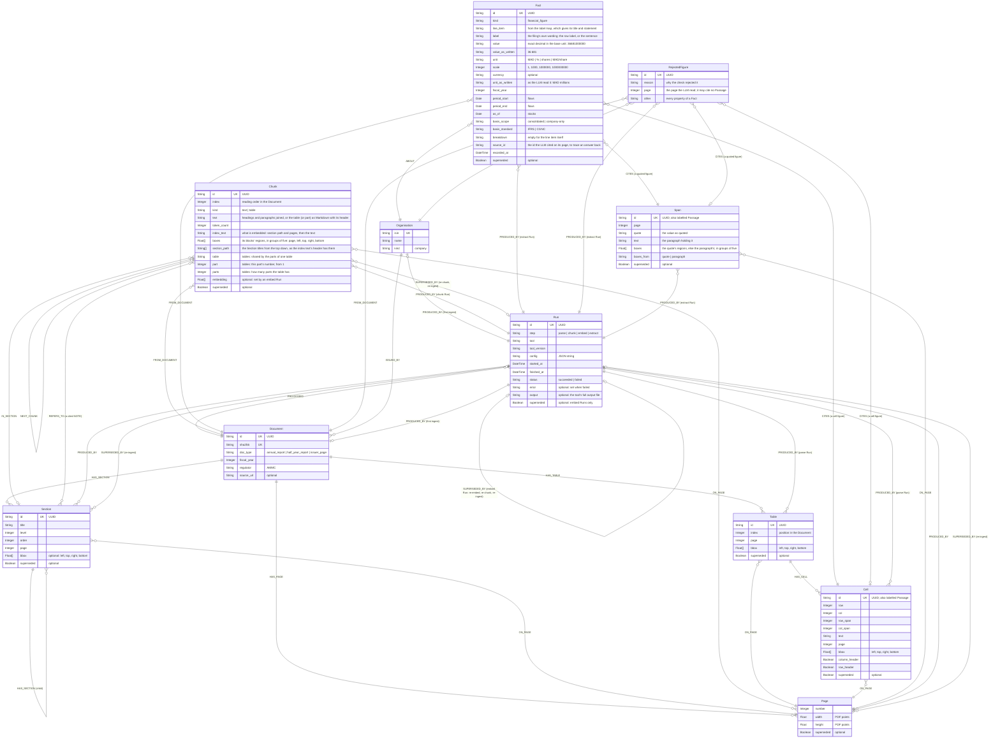

# Graph schema

The nodes and relationships that `Neo4jStore.record_parse`, `record_chunks`, `record_embeddings` and `record_extraction` (`backend/src/bloomberg_invest/adapters/store/neo4j_store/`) write for one ingested filing. Update this file when the store writes a new label, property or relationship.

Arrows in Cypher run from the first entity to the second, for example `(:Document)-[:ISSUED_BY]->(:Organisation)` and `(:Run)-[:PROCESSED]->(:Document)`.

## Constraints and keys

Neo4j Community enforces uniqueness only. Required properties are enforced by the Pydantic domain models every write goes through (ADR 0003).

| Label | Unique | Matched on when ingesting |
| --- | --- | --- |
| Organisation | `isin` | `isin`, given on the CLI |
| Document | `id`, `sha256` | `sha256` of the PDF |
| Run | `id` | always created |
| Section | `id` | always created |
| Page | none | always created, per Run |
| Chunk | `id` | always created, per chunk Run |
| Table, Cell | `id` | always created, per parse Run |
| Fact, RejectedFigure, Span | `id` | always created, per extract Run |

The vector index `chunk_embedding` covers `Chunk.embedding`, cosine, at full precision: Neo4j quantizes vectors to bits by default, which would change the ranking the notebook measured.

## Superseded

A Page or Section with `superseded = true` came from an older parse of the same filing. A newer parse replaced it; the node is kept for history but hidden from the app.

1. Run A parses the PDF and writes its Pages and Sections, all current.
2. The same PDF is ingested again. The Document is matched by its `sha256`, so Run B processes the same Document.
3. In the same transaction, every current node Run A produced for this Document gets `superseded = true` and a `SUPERSEDED_BY` link to Run B.
4. Run B writes fresh Pages and Sections. Every read filters with `coalesce(n.superseded, false) = false`, so only Run B's output shows.

A chunk Run supersedes only the Chunks of earlier chunk Runs, never the parse's Pages and Sections. An extract Run likewise supersedes only earlier extract Runs' Facts, RejectedFigures and Spans; a new parse supersedes its Tables and Cells and, through them, every figure extracted from them. A new parse supersedes everything earlier Runs produced for the Document, Chunks included; ingest then chunks the new parse. A superseded Chunk loses its `index_text` and `embedding`, so it leaves the vector index and search never returns it.

An embed Run sets the `embedding` of every current Chunk of its Document, never some of them, so its `PROCESSED` link to the Document says which Run made each vector: there is no link per Chunk. Its `config` names the model and the chunk Run it embedded. An embed Run vouches for the vectors of the current Chunks, so whatever replaces them ends it: a later embed Run, a re-chunk or a new parse marks it `superseded` with `SUPERSEDED_BY`, in the same transaction. A Document whose re-chunk stopped before its embed therefore has no current embed Run, rather than one naming Chunks that are gone.

Old nodes are never deleted (ADR 0002): anything that cited them stays traceable, and two parses can be compared. The property is absent on current nodes. Organisation and Document are shared across runs and never superseded, and of the Runs only embed Runs are; the Organisation and Document link by `PRODUCED_BY` to the Run that first created them, and a re-ingest only matches them.

## Failed Runs

A parse that fails still leaves a Run, with `status = 'failed'` and `error` set (for example `RuntimeError: ...`). It writes no Pages or Sections and supersedes nothing, so the last good parse stays current. Reads use the latest succeeded parse Run only; a filing with no succeeded parse is not listed. A failed chunk, embed or extract Run works the same way: no Chunks or vectors written, nothing superseded, the last good ones stay current.

## Where section text lives

In Chunks. A Section holds only its heading: `title`, `page`, the heading's `bbox`, `level` (inferred from the heading's numbering, since Docling returns every heading at level 1) and `order` (document order, parents before children). A section runs from its heading to the next heading at the same or a higher level.

The body text is in the stored PDF (`data/documents/<sha256>.pdf`) and in Docling's full output, which every successful parse saves to `data/parses/<sha256>/<started_at>-docling.json` and names in `Run.output`. The chunk Run reads that file instead of parsing again (`bloomberg chunk <document id>` re-runs it). A section's paragraphs form one text Chunk under the `CHUNK_CAP` (2,000 cl100k tokens), split at numbered points, otherwise evenly between paragraphs; each table, joined across pages, is its own Chunk holding its Markdown. A table whose rows, read one line per row as search reads them, are over the `TABLE_CAP` (1,500 cl100k tokens) is cut evenly between rows; each part repeats the column header and the headings above the table, keeps the pages and boxes of its own rows, and shares a `table` id with the other parts (`part` of `parts`). A heading starts the Chunk after it, so the Section's title is in its text and no text is lost when Docling takes a sentence for a heading; a heading with no content of its own joins the next Chunk. Chunks are the search unit (ADR 0004).

## Where figures live

A financial figure is a Fact (ADR 0001) of kind `financial_figure`, extracted page by page by an LLM and checked in Python before it is stored (#19 R6). It `CITES` its Passage: the table Cell holding its number, or a Span, the quoted value in its paragraph. Every Table and Cell comes from the parse, with its page and box, so the source viewer can highlight the exact cell.

A figure whose value does not equal its Cell's number, or that its paragraph does not contain, is stored as a `RejectedFigure` with its `reason`, never with the `Fact` label: a query on `:Fact` cannot show one. A RejectedFigure still `CITES` the Cell or Span it named, for the review queue (#23), and is `ABOUT` its Organisation and `FROM_DOCUMENT` its Document like a Fact. Every RejectedFigure keeps the `page` the LLM read, because one whose source id is not on the page (`unknown_source`) has no Passage to cite; a Fact's page is its Passage's.

A Fact keeps the label map's `line_item` key only; its title and statement are read from the label map in force. A Span's boxes are the quote's, found in the PDF's text layer inside its paragraph, so the viewer highlights the value; when the text layer does not hold the quote there, they are the paragraph's (`boxes_from`).

`value` is a string because Neo4j has no decimal type and a float would make `4,01` unequal to `4.01`. The extract Run's `config` names the deployment, the prompt and label map versions with their SHA-256, and the parse Run it read.

## Why a Page has width and height

`bbox` is in PDF points with a top-left origin. To highlight a source on the page image at any screen size, the viewer places the box as fractions of the page: `left / width`, `top / height`. Sizes are stored per page because reports mix portrait A4 (595 × 842 pt) with landscape tables. The viewer also sets them on the page image so it keeps its shape while loading.
