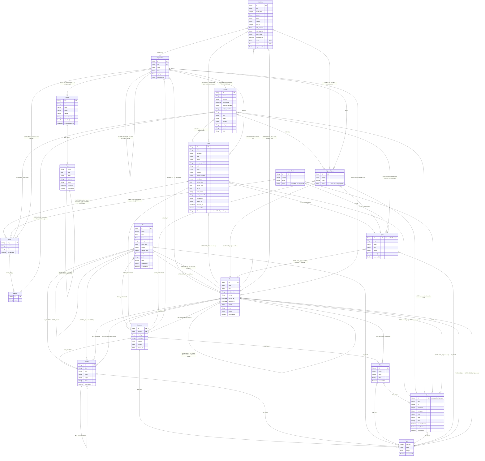

# Graph schema

The nodes and relationships that `Neo4jStore.record_parse`, `record_chunks`, `record_embeddings`, `record_extraction`, `record_fact_extraction`, `record_links`, `record_review` and `record_name_review` (`backend/src/bloomberg_invest/adapters/store/neo4j_store/`) write for one ingested filing. Update this file when the store writes a new label, property or relationship.

The diagram gives the shape; [Attributes](#attributes) gives every property's meaning and an example from the Maroc Telecom 2025 report.



Arrows in Cypher run from the first entity to the second, for example `(:Document)-[:ISSUED_BY]->(:Organisation)` and `(:Run)-[:PROCESSED]->(:Document)`.

## Nodes, labels and relationships

- **Every box is a node label.** A node can carry more than one label.
- **Passage is a second label, not a node type of its own.** Every Cell node is `:Cell:Passage` and every Span node is `:Span:Passage`. A Passage is what a Fact cites, or a correction: the table cell or the quoted sentence its value comes from. Reads match `(:Fact)-[:CITES]->(:Passage)` so they need not ask which kind it is. No node is a Passage alone.
- **Relationships carry no properties, but two.** Their type and direction are the whole meaning; anything worth recording, such as when or by which tool, is a property of a node, usually the Run that `PRODUCED_BY` points to. The exceptions belong to one link, not to either node: `NAMES` holds the party's `role` in the fact and how that fact writes it, since an Alias is shared by every fact writing the name; `ALIAS_OF` holds `by`, the id of the link Run or the Review that made it, and once a later decision replaces it, `superseded = true` and `superseded_by`, that decision's Review id: it is kept, never deleted.

One figure, as stored:

```
(:Organisation {isin: "MA0000011488"})<-[:ABOUT]-(f:Fact {line_item: "revenue", value_as_written: "36 681"})
(f)-[:CITES]->(:Cell:Passage {text: "36 681", row: 1, col: 3})-[:ON_PAGE]->(:Page {number: 4})
(f)-[:FROM_DOCUMENT]->(:Document {doc_type: "annual_report", fiscal_year: 2025})
(f)-[:PRODUCED_BY]->(:Run {step: "extract", tool: "azure-openai"})
(:Table {page: 4})-[:HAS_CELL]->(the Cell)
```

## Attributes

An optional property is absent from the node when it has no value: Neo4j stores no nulls. Boxes are in PDF points with a top-left origin; see [Why a Page has width and height](#why-a-page-has-width-and-height).

### Organisation

| Property | Type | Meaning | Example |
| --- | --- | --- | --- |
| `id` | String, unique | UUID; how facts' names link to it | `0b3c…` |
| `isin` | String, unique, optional | the ISIN given on the CLI, for an issuer | `MA0000011488` |
| `name` | String | as given on the CLI, or in CHECKS Names | `Maroc Telecom` |
| `kind` | String | `company`, `holding`, `state`, `pension_fund`, `insurer`, `bank`, `audit_firm`, or `aggregate` | `company` |
| `aggregate` | String, Aggregates only | `free_float` or `treasury_shares` | `free_float` |
| `aggregate_of` | String, Aggregates only | the `id` of the company it is `AGGREGATE_OF`; one Aggregate per company and kind | `0b3c…` |

### Person

A director, auditor's partner or other person a fact names, created when a person resolves the name in CHECKS Names (`new`).

| Property | Type | Meaning | Example |
| --- | --- | --- | --- |
| `id` | String, unique | UUID | `5c2e…` |
| `name` | String | as given in CHECKS | `Lamia Lemkecher` |

### Alias

A name as facts write it, shared by every fact and filing writing the same name: a person resolves it once (#19 R7). Never superseded.

| Property | Type | Meaning | Example |
| --- | --- | --- | --- |
| `key` | String, unique | the full name normalised: lower case, no accents, punctuation or legal forms (`domain/names.py`); an aggregate's is `<kind>:<its company's key>` | `itissalat al maghrib`; `free_float:maroc telecom` |
| `name` | String | the full name the extractor read, the first time | `Itissalat Al-Maghrib` |
| `kind` | String | what the extractor proposed it is | `company` |
| `not_a_party` | Boolean, optional | a person said it is no Organisation or Person | `true` |

### Document

| Property | Type | Meaning | Example |
| --- | --- | --- | --- |
| `id` | String, unique | UUID | `c5709e7d-f060-41a4-8764-f76960b98aba` |
| `sha256` | String, unique | of the PDF; a re-ingest matches on it | `90e8b73c7f11…` |
| `doc_type` | String | `annual_report`, `half_year_report` or `issuer_page` | `annual_report` |
| `fiscal_year` | Integer | the year the filing reports on | `2025` |
| `regulator` | String | always `AMMC` | `AMMC` |
| `currency` | String | ISO 4217 code of the currency its financial statements are presented in, stated at ingest (`--currency`, default `MAD`). A figure in another currency (a translation, such as "Chiffres consolidés en euro") is kept but needs no check and feeds no KPI (#56) | `MAD` |
| `source_url` | String, optional | where the PDF was downloaded | `https://www.ammc.ma/…/Maroc_Telecom_RFA_2025.pdf` |

### Run

One execution of a step. `config` is a JSON string whose keys depend on the step.

| Property | Type | Meaning | Example |
| --- | --- | --- | --- |
| `id` | String, unique | UUID | `0d43fb28-03f5-42c5-b558-2fc4512df0eb` |
| `step` | String | `parse`, `chunk`, `embed`, `extract`, `extract_facts`, `link` or `compute` | `parse` |
| `tool` | String | `docling`, `bloomberg-chunker`, `sentence-transformers`, `azure-openai` or `bloomberg-invest` | `docling` |
| `tool_version` | String | the tool's package version | `2.145.0` |
| `config` | String (JSON) | the settings the output depends on | see below |
| `started_at`, `finished_at` | DateTime | UTC | `2026-11-09T13:36:59Z` |
| `status` | String | `succeeded` or `failed` | `succeeded` |
| `error` | String, optional | set when failed | `RuntimeError: …` |
| `output` | String, optional | the tool's full output file, under `data/` | `parses/90e8b73c…/20261109T133659Z-docling.json` |
| `superseded` | Boolean, optional | embed Runs only | `true` |

`config` by step:

- **parse:** `{"do_cell_matching": "true", "mode": "accurate", "table_structure": "TableFormer v1"}`
- **chunk:** `{"cap": "2000", "table_cap": "1500", "tokenizer": "cl100k_base", "parser": "docling 2.145.0", "parse_run": "0d43fb28-…"}`
- **embed:** `{"model": "Qwen/Qwen3-Embedding-0.6B", "max_tokens": "2048", "chunk_run": "59e09a42-…"}`
- **extract:** `{"api": "openai/v1", "deployment": "gpt-5.6-sol", "prompt": "extract-figures v1", "prompt_sha256": "2e0590a8…", "label_map": "v1", "label_map_sha256": "7ef25890…", "pages": "88", "parse_run": "0d43fb28-…", "replayed": "true"}`
- **compute:** `{"kpi_rules": "v1", "kpi_rules_sha256": "4b1c…", "label_map": "v1"}`. A compute Run `PROCESSED` the Organisation whose KPI values it computed, not a Document.

### Page

| Property | Type | Meaning | Example |
| --- | --- | --- | --- |
| `number` | Integer | from 1 | `4` |
| `width`, `height` | Float | PDF points | `595.32`, `841.92` (A4 portrait) |
| `superseded` | Boolean, optional | | `true` |

### Section

| Property | Type | Meaning | Example |
| --- | --- | --- | --- |
| `id` | String, unique | UUID | `1a4e2219-…` |
| `title` | String | the heading as printed | `1.1 Chiffres consolidés en dirham` |
| `level` | Integer | from the heading's numbering, 1 at the top | `2` |
| `order` | Integer | document order, parents before children | `3` |
| `page` | Integer | the heading's page | `4` |
| `bbox` | Float[4], optional | the heading's box: left, top, right, bottom | `[82.0, 142.5, 272.0, 153.2]` |
| `superseded` | Boolean, optional | | `true` |

### Chunk

| Property | Type | Meaning | Example |
| --- | --- | --- | --- |
| `id` | String, unique | UUID | `4a23a048-…` |
| `index` | Integer | reading order in the Document | `75` |
| `kind` | String | `text` or `table` | `table` |
| `text` | String | headings and paragraphs joined, or the table (part) as Markdown with its header | `TABLEAU DES FLUX DE TRÉSORERIE CONSOLIDÉS ⏎ \| (En millions MAD) \| …` |
| `token_count` | Integer | cl100k tokens in `text` | `622` |
| `index_text` | String | what is embedded: section path and pages, then the text | `3. COMPTES CONSOLIDÉS … > TABLEAU DES FLUX … ⏎ …` |
| `boxes` | Float[] | its blocks' regions, five numbers each: page, left, top, right, bottom | `[25, 48.6, 59.4, 377.8, 71.1, …]` |
| `section_path` | String[] | Section titles from the top down | `["3. COMPTES CONSOLIDÉS …", "TABLEAU DES FLUX DE TRÉSORERIE CONSOLIDÉS"]` |
| `table` | String, tables only | shared by the parts of one table | `7feb1ce9-…` |
| `part`, `parts` | Integer, tables only | this part's number from 1, and how many | `1`, `2` |
| `embedding` | Float[1024], optional | set by an embed Run | 1,024 floats |
| `superseded` | Boolean, optional | a superseded Chunk loses `index_text` and `embedding` | `true` |

### Table

| Property | Type | Meaning | Example |
| --- | --- | --- | --- |
| `id` | String, unique | UUID | `b66e5c20-…` |
| `index` | Integer | position in the Document | `1` |
| `page` | Integer | | `4` |
| `bbox` | Float[4] | left, top, right, bottom | `[52.8, 193.8, 520.1, 335.2]` |
| `superseded` | Boolean, optional | | `true` |

### Cell (also `:Passage`)

| Property | Type | Meaning | Example |
| --- | --- | --- | --- |
| `id` | String, unique | UUID | `c0556947-…` |
| `row`, `col` | Integer | from 0 | `1`, `3` |
| `row_span`, `col_span` | Integer | merged cells span more than 1 | `1`, `1` |
| `text` | String | as the parser read it | `36 681` |
| `page` | Integer | | `4` |
| `bbox` | Float[4] | left, top, right, bottom | `[488.1, 221.2, 515.7, 229.3]` |
| `column_header`, `row_header` | Boolean | | `false`, `false` |
| `superseded` | Boolean, optional | | `true` |

### Span (also `:Passage`)

A figure quoted in a paragraph rather than read from a table.

| Property | Type | Meaning | Example |
| --- | --- | --- | --- |
| `id` | String, unique | UUID | `85a8f122-…` |
| `page` | Integer | | `10` |
| `quote` | String | the value as quoted | `4,00` |
| `text` | String | the whole paragraph | `Le Conseil d'Administration de Maroc Telecom proposera à la prochaine Assemblée Générale …` |
| `boxes` | Float[] | five numbers per region: page, left, top, right, bottom | `[10, 173.0, 464.5, 190.1, 472.3]` |
| `boxes_from` | String | `quote` when the quote was found in the PDF's text layer, else `paragraph` | `quote` |
| `superseded` | Boolean, optional | | `true` |

### Fact

A financial figure that passed the check. Example: consolidated revenue for 2025.

| Property | Type | Meaning | Example |
| --- | --- | --- | --- |
| `id` | String, unique | UUID | `06bb8020-…` |
| `kind` | String | `financial_figure`; other kinds come later | `financial_figure` |
| `line_item` | String | key in the label map, which gives its title and statement | `revenue` |
| `label` | String | the filing's own wording: the row label, or the sentence | `Chiffre d'affaires` |
| `value_as_written` | String | exactly as printed | `36 681` |
| `unit_as_written` | String | the unit as the LLM read it | `MAD millions` |
| `value` | String | exact decimal in the base unit | `36681000000` |
| `unit` | String | `MAD`, `%`, `shares` or `MAD/share` | `MAD` |
| `scale` | Integer | 1, 1000, 1000000 or 1000000000 | `1000000` |
| `currency` | String, optional | absent for `%` and `shares` | `MAD` |
| `fiscal_year` | Integer | | `2025` |
| `period_start`, `period_end` | Date, flows only | the period it covers | `2025-01-01`, `2025-12-31` |
| `as_of` | Date, stocks only | the day a balance holds on | `2023-12-31` (current assets, FY2023) |
| `basis_scope` | String | `consolidated` or `company-only` | `consolidated` |
| `basis_standard` | String | `IFRS` or `CGNC`, from the scope | `IFRS` |
| `breakdown` | String | empty for the line item itself, else the part | `""`; `basic` for basic EPS |
| `source_id` | String | the id the LLM cited on its page: `t<page>.<table>.r<row>.c<col>` or `p<page>.<paragraph>` | `t4.0.r1.c3` |
| `recorded_at` | DateTime | when the extract Run stored it | `2026-11-09T22:12:43Z` |
| `superseded` | Boolean, optional | | `true` |

### Fact of the other eight kinds

A shareholding, board seat, audit mandate, listing, consolidation, dividend, auditor opinion or related-party agreement that passed the check (#24). It `NAMES` each party through an Alias, with the party's `role` (`holder` and `held`, `member` and `company`, `auditor` and `company`, `company` and `exchange`, `parent` and `subsidiary`, `company`, `company`, `company` and `counterparty`). Its other properties are its kind's fields (`domain/facts.py`, `SPECS`), as the LLM copied them, plus:

| Property | Type | Meaning | Example |
| --- | --- | --- | --- |
| `kind` | String | the kind | `shareholding` |
| `percent`, `shares`, `interest`, `control`, `amount` | String, by kind, optional | numbers exactly as printed | `53` |
| `rights`, `body`, `role`, `status`, `method`, `opinion`, `measure`, `nature`, `ticker`, `isin`, `compartment`, `sector`, `partner` | String, by kind | as the kind defines them | `capital`; `full`; `per_share` |
| `emphasis` | Boolean, auditor opinions | an emphasis of matter | `true` |
| `basis_scope` | String, mandates and opinions | `consolidated` or `company-only` | `consolidated` |
| `unit_as_written` | String, amounts | the unit as stated | `MAD billions` |
| `amount_value`, `scale`, `currency` | amounts | the amount in its base unit, exact, as for a figure's `value` | `3500000000`, `1000000000`, `MAD` |
| `as_of` | Date, as-of kinds | shareholdings, board seats, listings, consolidation | `2025-12-31` |
| `fiscal_year`, `period_start`, `period_end` | fiscal-year kinds | mandates, dividends, opinions, agreements | `2025`, `2025-01-01`, `2025-12-31` |
| `quote` | String | the words of its paragraph, or its cell's row, that state it | `Etisalat : 53% ;` |
| `source_id`, `recorded_at`, `superseded` | | as on a figure | |

### RejectedFact

A fact of the eight other kinds that failed the check, with the same properties as the Fact it would be (`as_of` stays the LLM's text), its `page`, and its `reason`: `its source id is not on the page`, `its quote is not in its source`, `a party has no name`, `it states nothing`, `a number it states is not one number`, `a number it states is not in its quote`, `its date is not a date`, `its number is not in the cell it cites`, `its year is not on its page`, `its unit names no currency`. `GET /api/rejected-facts` lists them.

### RejectedFigure

What the LLM proposed, kept with the reason the check refused it. It holds only what the LLM said and what was read from its source: `id`, `kind`, `line_item`, `label`, `value_as_written`, `unit_as_written`, `fiscal_year`, `basis_scope` (when valid), `breakdown`, `source_id` and `recorded_at`, as on a Fact, plus the two below. The parsed properties (`value`, `unit`, `scale`, `currency`, the period and `basis_standard`) are never set.

| Property | Type | Meaning | Example |
| --- | --- | --- | --- |
| `reason` | String | one of the reasons below | `its value differs from its cell` |
| `page` | Integer | the page the LLM read | `26` |

The reasons, in the order they are checked: `its source id is not on the page`, `its value differs from its cell`, `its value is not in its paragraph`, `its value is not one number`, `its unit names no currency, percentage or share count`, `its line item is not in the label map`, `its scope is neither consolidated nor company-only`.

Examples:
- **Value differs:** the LLM proposed `18 002` for equity, but the cell it cited reads `propres 18 002`, part of a label merged into it. It `CITES` that Cell.
- **Unknown source:** the LLM cited `t46.0.r8.c2+t46.0.r8.c3`, two cells joined, which is no id on page 46. It cites nothing.

### Review

A person's check of figures in CHECKS (#23). One Review `REVIEWS` every figure of one CHECKS row: the Facts of one filing stating one value of a line item and year, or one RejectedFigure. A correction's properties are absent on an acceptance or a reopening. A Review of one Fact of the other kinds keeps its value in a Conflict (`accepted`) or undoes that (`reopened`, D5). A Review of an Alias records what a person decided the name stands for (`same_as` with `party_id`, `new` with `name` and `kind`, `not_a_party`, or `reopened`).

| Property | Type | Meaning | Example |
| --- | --- | --- | --- |
| `id` | String, unique | UUID | `5e1f0c2a-…` |
| `verdict` | String | `accepted`, `corrected`, or `reopened` to undo the check before | `corrected` |
| `reviewer` | String | the app's `REVIEWER` setting | `Z. Bajjou` |
| `reviewed_at` | DateTime | UTC | `2026-11-10T14:02:11Z` |
| `value_as_written` | String, corrections | the right value, as the person gave it | `17 920` |
| `unit_as_written` | String, corrections | the figure's own, which the value is read in | `MAD millions` |
| `value`, `unit`, `scale`, `currency` | corrections | parsed as on a Fact | `17920000000`, `MAD`, `1000000`, `MAD` |

### KpiValue

One KPI of one company for one fiscal year (#27), computed in Python by a compute Run from the company's checked consolidated figures and declared dividends under one version of `config/kpis/`. It is kept whether or not it has a value: "-" and why is a result too (#19 R12). It is `VALUE_OF` the Organisation and `COMPUTED_FROM` every Fact it read; a corrected RejectedFigure it read is linked too.

| Property | Type | Meaning | Example |
| --- | --- | --- | --- |
| `id` | String, unique | UUID | `c2e4…` |
| `kpi` | String | its name in `config/kpis/` | `net_debt_to_ebitda` |
| `fiscal_year` | Integer | | `2025` |
| `status` | String | `computed`, `not_meaningful`, `missing`, `conflict` or `unchecked` | `computed` |
| `value` | String, optional | exact decimal, nine places; a ratio as a fraction, a score as the tests passed | `0.953712215` |
| `reason` | String | why there is no value, naming each input and year; empty when computed | `Waiting for check: EBITDA FY2025` |
| `out_of` | Integer, optional | a score's tests counted: those that are meaningful for the company | `8` |
| `rule_version`, `rule_sha256` | String | the KPI rules it was computed under | `v1`, `4b1c…` |
| `label_map` | String | the label map version its figures were read with | `v1` |
| `computed_at` | DateTime | UTC, its compute Run's end | `2026-11-13T10:02:11Z` |
| `used` | String (JSON) | each input it read, `[name, fiscal year]` | `[["ebitda", 2025]]` |
| `tests` | String (JSON) | a score's tests, `[name, status, passed, reason]` | `[["roa_positive", "computed", true, ""]]` |
| `superseded` | Boolean, optional | `true` once a later compute Run replaced it | `true` |

### Listing

A share as its exchange lists it (#26). Every share the Bourse de Casablanca lists has one, refreshed from the exchange's issuer list on each price run; a share it no longer lists keeps its Listing and Prices. An Organisation is `LISTED_AS` its Listing when `config/listings/` gives the ticker's ISIN: the exchange's list has none.

| Property | Type | Meaning | Example |
| --- | --- | --- | --- |
| `key` | String, unique | `mic:ticker`, what its Prices name it by | `XCAS:IAM` |
| `mic`, `ticker` | String, unique together | the exchange (ISO 10383) and the share's symbol there | `XCAS`, `IAM` |
| `name` | String | as the exchange lists it | `ITISSALAT AL-MAGHRIB` |
| `sector`, `compartment` | String | as the exchange lists them | `Télécommunications`, `Principal A` |
| `refreshed_at` | DateTime | UTC, the last price run that saw it listed | `2026-11-11T17:30:02Z` |
| `prices_written_at` | DateTime | UTC, the last answer whose closes were written; setting it locks the share, so two runs at once take turns | `2026-11-11T17:30:04Z` |

### Price

A daily close of one Listing: market data, not a Fact, so no Run (#19 R3 lists none). A session and source has one current close. The same close again writes nothing; a later answer with another close is reported as drift by the daily run and supersedes the stored one, which is kept with `superseded = true` and `SUPERSEDED_BY` the new one (#19 R4). An older answer, as a replay reads, never undoes a newer close.

| Property | Type | Meaning | Example |
| --- | --- | --- | --- |
| `listing`, `date`, `source`, `fetched_at` | unique together | the Listing's `key`, the session, where the close came from (`bourse-casablanca`, or `manual` from a CSV), and when, in UTC | `XCAS:IAM`, `2026-11-10`, `bourse-casablanca`, `2026-11-10T17:30:04Z` |
| `close` | String | a decimal without trailing zeros, so one close is written one way; raw, not adjusted for dividends | `91.7` |
| `currency` | String | ISO 4217 | `MAD` |
| `superseded` | Boolean | `true` once a later answer gave another close; absent while current | `true` |

## Constraints and keys

Neo4j Community enforces uniqueness only. Required properties are enforced by the Pydantic domain models every write goes through (ADR 0003).

| Label | Unique | Matched on when ingesting |
| --- | --- | --- |
| Organisation | `id`; `isin` | `isin`, given on the CLI; an Aggregate on `(aggregate, aggregate_of)` |
| Person | `id` | always created, in CHECKS Names |
| Alias | `key` | `key`, from the name a fact writes |
| Document | `id`, `sha256` | `sha256` of the PDF |
| Run | `id` | always created |
| Section | `id` | always created |
| Page | none | always created, per Run |
| Chunk | `id` | always created, per chunk Run |
| Table, Cell | `id` | always created, per parse Run |
| Fact, RejectedFigure, RejectedFact, Span | `id` | always created, per extract or extract_facts Run |
| Review | `id` | always created, per check; never superseded |
| KpiValue | `id` | always created, by a compute Run, for each KPI and year whose result changed |
| Listing | `key`; `(mic, ticker)` | `(mic, ticker)` from the exchange's list |
| Price | `(listing, date, source, fetched_at)` | the current close of `(listing, date, source)`: the same close writes nothing, another one from a later answer supersedes it. "One current close" is kept by the write, in the share's transaction: Community has no partial uniqueness |

The vector index `chunk_embedding` covers `Chunk.embedding`, cosine, at full precision: Neo4j quantizes vectors to bits by default, which would change the ranking the notebook measured.

## Superseded

A Page or Section with `superseded = true` came from an older parse of the same filing. A newer parse replaced it; the node is kept for history but hidden from the app.

1. Run A parses the PDF and writes its Pages and Sections, all current.
2. The same PDF is ingested again. The Document is matched by its `sha256`, so Run B processes the same Document.
3. In the same transaction, every current node Run A produced for this Document gets `superseded = true` and a `SUPERSEDED_BY` link to Run B.
4. Run B writes fresh Pages and Sections. Every read filters with `coalesce(n.superseded, false) = false`, so only Run B's output shows. The exceptions are the reads by id (`GET /api/chunks/{id}`, `GET /api/facts/{id}`), which return a node current or not so a link to it keeps working after a re-run.

A chunk Run supersedes only the Chunks of earlier chunk Runs, never the parse's Pages and Sections. An extract Run likewise supersedes only earlier extract Runs' Facts, RejectedFigures and Spans; a new parse supersedes its Tables and Cells and, through them, every figure extracted from them. A new parse supersedes everything earlier Runs produced for the Document, Chunks included; ingest then chunks the new parse. A superseded Chunk loses its `index_text` and `embedding`, so it leaves the vector index and search never returns it.

An embed Run sets the `embedding` of every current Chunk of its Document, never some of them, so its `PROCESSED` link to the Document says which Run made each vector: there is no link per Chunk. Its `config` names the model and the chunk Run it embedded. An embed Run vouches for the vectors of the current Chunks, so whatever replaces them ends it: a later embed Run, a re-chunk or a new parse marks it `superseded` with `SUPERSEDED_BY`, in the same transaction. A Document whose re-chunk stopped before its embed therefore has no current embed Run, rather than one naming Chunks that are gone.

Old nodes are never deleted (ADR 0002): anything that cited them stays traceable, and two parses can be compared. The property is absent on current nodes. Organisation and Document are shared across runs and never superseded, and of the Runs only embed Runs are; the Organisation and Document link by `PRODUCED_BY` to the Run that first created them, and a re-ingest only matches them.

## Failed Runs

A parse that fails still leaves a Run, with `status = 'failed'` and `error` set (for example `RuntimeError: ...`). It writes no Pages or Sections and supersedes nothing, so the last good parse stays current. Reads use the latest succeeded parse Run only; a filing with no succeeded parse is not listed. A failed chunk, embed or extract Run works the same way: no Chunks or vectors written, nothing superseded, the last good ones stay current.

## Where section text lives

In Chunks. A Section holds only its heading: `title`, `page`, the heading's `bbox`, `level` (inferred from the heading's numbering, since Docling returns every heading at level 1) and `order` (document order, parents before children). A section runs from its heading to the next heading at the same or a higher level.

The body text is in the stored PDF (`data/documents/<sha256>.pdf`) and in Docling's full output, which every successful parse saves to `data/parses/<sha256>/<started_at>-docling.json` and names in `Run.output`. The chunk Run reads that file instead of parsing again (`bloomberg chunk <document id>` re-runs it). A section's paragraphs form one text Chunk under the `CHUNK_CAP` (2,000 cl100k tokens), split at numbered points, otherwise evenly between paragraphs; each table, joined across pages, is its own Chunk holding its Markdown. A table whose rows, read one line per row as search reads them, are over the `TABLE_CAP` (1,500 cl100k tokens) is cut evenly between rows; each part repeats the column header and the headings above the table, keeps the pages and boxes of its own rows, and shares a `table` id with the other parts (`part` of `parts`). A heading starts the Chunk after it, so the Section's title is in its text and no text is lost when Docling takes a sentence for a heading; a heading with no content of its own joins the next Chunk. Chunks are the search unit (ADR 0004).

## Where figures live

A financial figure is a Fact (ADR 0001) of kind `financial_figure`, extracted page by page by an LLM and checked in Python before it is stored (#19 R6). It `CITES` its Passage: the table Cell holding its number, or a Span, the quoted value in its paragraph. Every Table and Cell comes from the parse, with its page and box, so the source viewer can highlight the exact cell.

A figure that fails the check is stored as a `RejectedFigure` with its `reason`, never with the `Fact` label: a query on `:Fact` cannot show one. A RejectedFigure still `CITES` the Cell or Span it named, for the review queue (#23), and is `ABOUT` its Organisation and `FROM_DOCUMENT` its Document like a Fact. Every RejectedFigure keeps the `page` the LLM read, because one whose source id is not on the page has no Passage to cite; a Fact's page is its Passage's.

A Fact keeps the label map's `line_item` key only; its title and statement are read from the label map in force. A Span's boxes are the quote's, found in the PDF's text layer inside its paragraph, so the viewer highlights the value; when the text layer does not hold the quote there, they are the paragraph's (`boxes_from`).

`value` is a string because Neo4j has no decimal type and a float would make `4,01` unequal to `4.01`. The extract Run's `config` names the deployment, the prompt and label map versions with their SHA-256, and the parse Run it read.

## Where facts and names live

The eight other kinds of Fact come from their own Run step, `extract_facts`, with its own prompt (`config/prompts/extract_facts_v1.md`), page by page over every page with text; the figure pass is untouched (#24 D1). A fact is kept when its quote is in its source, its paragraph (or the few after it on the page) or its cell's table row or column; every number it states is in its quote, or for a table in that row or column, its first in the cell it cites; and its year is written on its page, whole or ending a date (`31-déc.-25`) (D2); it `CITES` that Cell or a Span of its quote, boxed in the PDF's text layer like a figure's.

Each party is written twice by the extractor: as the page writes it (`l'Etat`, on `NAMES`) and as the full name it means there (`Royaume du Maroc`), whose key is the Alias's. A `link` Run, after every `extract_facts` Run, links each Alias with no `ALIAS_OF` to the one Organisation or Person whose name, Listing name or resolved Alias has its key; none or several leaves it for CHECKS Names (D3). An aggregate Alias (`free_float:<key>`, `treasury_shares:<key>`) links to its company's Aggregate once the company's name is linked, never through CHECKS. A person's decision is a Review of the Alias; it supersedes the Alias's current `ALIAS_OF`, which is kept, and the company's aggregates follow it. Reads follow current links only.

An `extract_facts` Run supersedes earlier ones' Facts, RejectedFacts and Spans, never an Alias, an Organisation or Person, or a Review. A new Fact keeps the Review of the previous Run's Fact that read the same kind, names, values and source (#19 R4).

The dossier groups Facts by kind, parties (what each one resolves to, or its Alias until resolved) and details (the rights, body, scope, measure or nature), one row per fiscal year for the fiscal-year kinds. A row shows the latest date's value: one a person kept at that date; else an annual report's over an issuer page's; else the first recorded, and among values one Run recorded at once, the first in the filing's reading order (#19 R8). A value kept at an earlier date gives way to a later date's, and the row says so (`kept_earlier`). Values at the shown date that disagree, numbers beyond the precision they are written to, are a Conflict, and both stay visible.

## Where checks live

A figure's check in force is its latest `Review` (by `reviewed_at`), unless that one reopened it. Reviews are never superseded or deleted: a mistaken check is undone by a reopening, and both stay. Only consolidated figures that feed a KPI or screen need a check; `config/kpis/` names those inputs.

A correction never changes the figure: the Review holds the right value, and it wins wherever the figure is read (ADR 0001). It `CITES` what the person picked: a Cell of the figure's table row, or a new Span holding a number of the figure's paragraph, boxed on that number in the PDF's text layer. Such a Span has no `PRODUCED_BY`: its Review is its provenance, so a re-extract never supersedes it. A typed value cites nothing. The dossier shows a corrected figure with its correction, sourced from what the Review cites, or for a typed value from what the figure was read from; a RejectedFigure joins the dossier once corrected.

An extract Run carries checks over in its own transaction (#19 R4). A new figure gains a `REVIEWS` link from the check in force of the previous extract Run's figure that read the same thing:
- the same line item, fiscal year, scope, breakdown, `value_as_written` and `unit_as_written`;
- from the same source: for a Cell, the same page, table index, row and column, which survive a re-parse; for a Span, the same page, quote and paragraph.

Any other new figure starts unchecked and goes back to CHECKS, and so does every figure with no Passage: its page and `source_id` are not the same Cell. Only the Run just before counts, so a check undone by a different reading does not come back when a later Run reads the first value again.

One filing's check covers the value (#24 D4): a figure of another filing stating the value in force, within the precision it is written to, counts as checked and leaves CHECKS, which names the filing checked (`checked_in`). This is read, not stored: no Review links to it, and it is reopened where the check was made.

## Where KPI values live

A compute Run computes every KPI of one company for every fiscal year it has inputs for, compares each result with the current KpiValue (status, value, reason, tests counted, rule and label map versions, inputs and Facts read), and writes only those that differ, superseding the one each replaces with `SUPERSEDED_BY` the Run. A correction therefore supersedes only the values that read the corrected figure (#27 AC3), and a run that changes nothing writes no Run.

A check of a figure or a declared dividend computes the KPI values with the check applied, and writes the Review, the compute Run and its KpiValues in one transaction: if any part fails, none is kept. The CLI's `ingest`, `extract` and `facts`, the only entry points that extract, end with a compute Run of their own for the company; so does `bloomberg kpis`, after a new rule version.

An input's value is the one in force across the company's filings, as the dossier shows it (#19 R8, #24 D4). When filings state different values, the one a person checked counts; until one is, the KPI reads "two values". The scorecard reads the current values; the KPIs page reads the rules.

## Where closes live

Closes are kept in Neo4j with the graph (ADR 0003): about 60,000 Prices for three years of the 81 listed shares, and 81 more a day. Reads ask for one share between two dates, an index lookup on the Price key; averages and medians are computed in Python, as every KPI is. If price analytics outgrow it, ADR 0003 names Postgres as the way out, behind the same store methods.

Every answer the Bourse gives is also kept as returned, under the gitignored `data/prices/raw/` (`<ticker>/<fetched at>_<start>_<end>_p<page>.json`, and `listings/`, `holidays/` for its pages). `bloomberg prices replay` rebuilds the Prices from them by the same rules, if a parsing mistake is ever found: the Bourse keeps only three years.

## Why a Page has width and height

`bbox` is in PDF points with a top-left origin. To highlight a source on the page image at any screen size, the viewer places the box as fractions of the page: `left / width`, `top / height`. Sizes are stored per page because reports mix portrait A4 (595 × 842 pt) with landscape tables. The viewer also sets them on the page image so it keeps its shape while loading.
